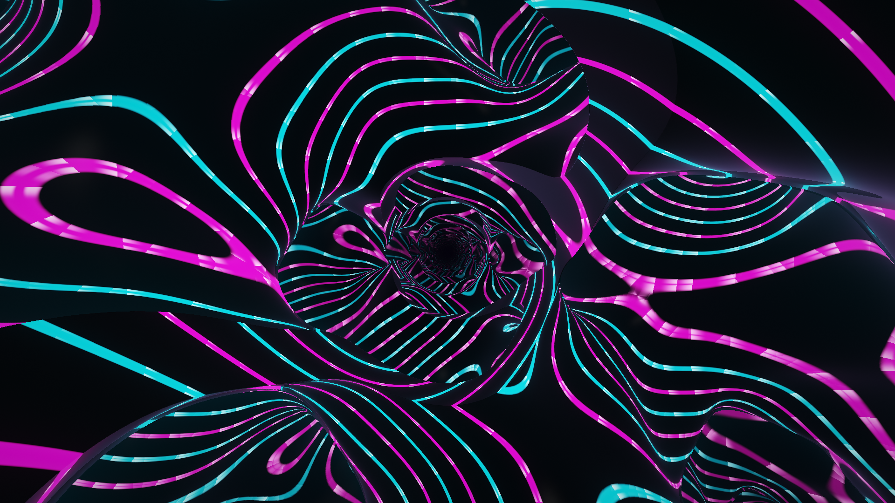
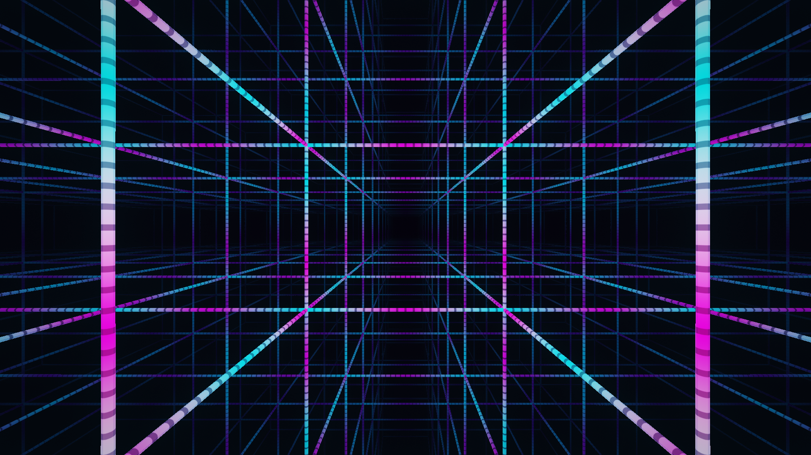
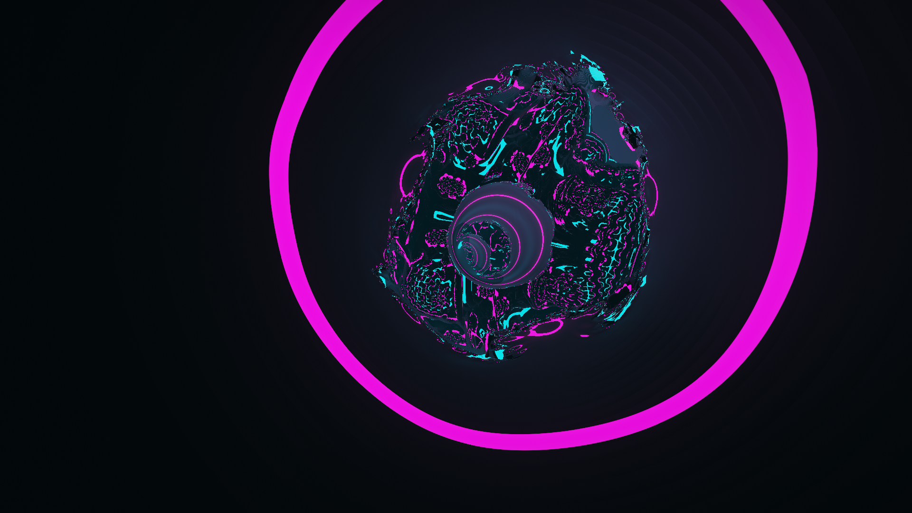
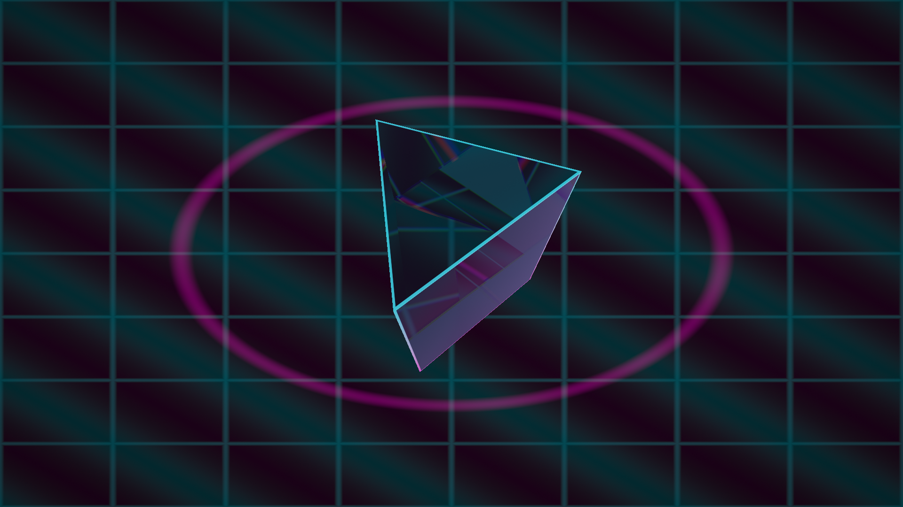
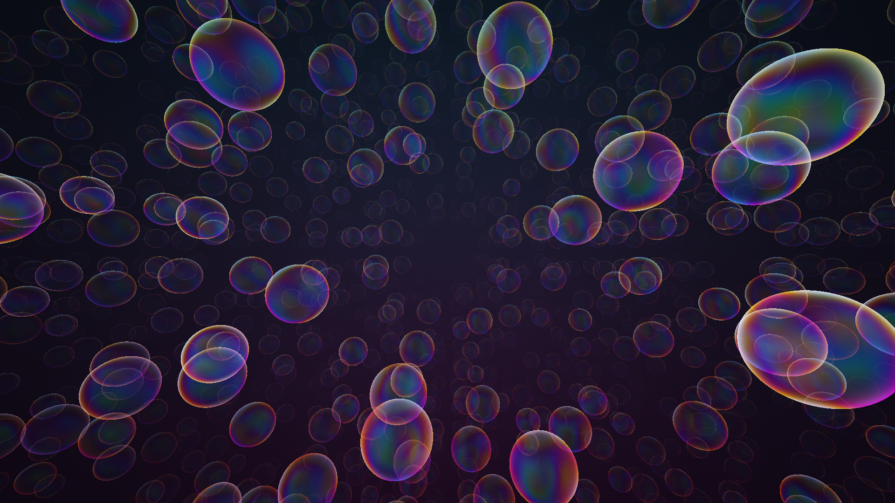
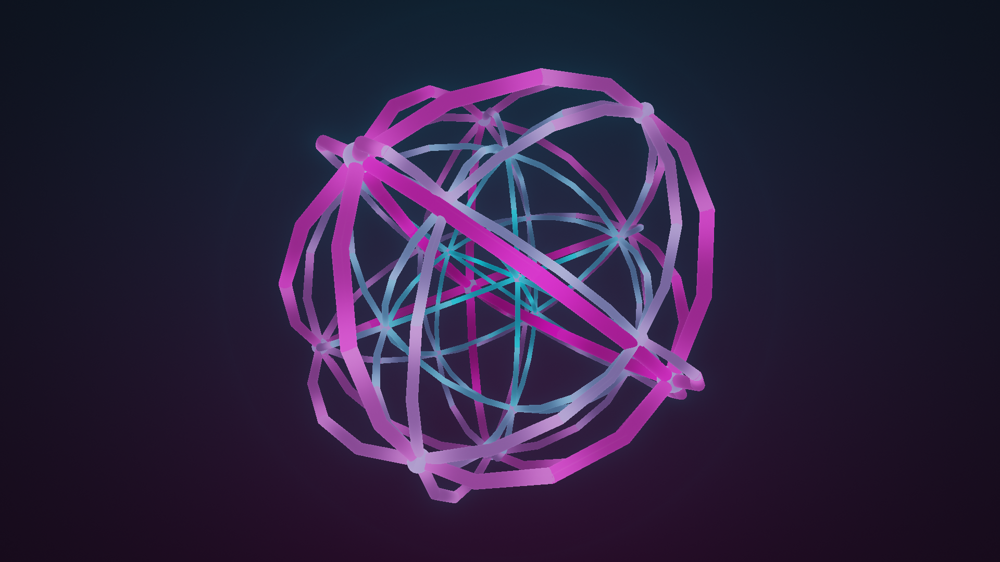

# WorldEhr

Real-time 3D scenes and video effects for **Resolume Arena** on Apple silicon Macs. Free download, by Creativeations.

WorldEhr is one FFGL plugin built as two bundles:

| Bundle | Shows up in Arena as | What it does |
|---|---|---|
| `WorldEhr.bundle` | **WorldEhr** (Sources) | Every scene generates its own image. |
| `WorldEhrFX.bundle` | **WorldEhr FX** (Effects) | The same scenes, fed by the clip or layer below: your video as a texture, a reflection, or light. |

Both carry the same 23 scenes. Pick one with the **Effect** dropdown; each scene shows only its own dials.

**[Download the latest release](https://github.com/AmritusG/WorldEhr/releases/latest)**

| | |
|---|---|
|  |  |
| Gyroid Cave, Edge Pulses on | Infinity Mirror Room |
|  |  |
| Fractal Worlds, Fly mode | Glass Prism FX |
|  |  |
| Soap Film Void | Tesseract, Polytope 24-Cell |

*Rendered offline from the plugin's own shaders at 1920 x 1080.*

## Requirements

- A Mac with **Apple silicon** (M1 or later). There is no Intel build.
- **macOS 11** Big Sur or later (tested on macOS 27).
- **Resolume Arena 7** (tested on Arena 7.28.1).

The bundles are signed with a Developer ID and notarised by Apple.

## Install

1. Download `WorldEhr-<version>.zip` from [Releases](https://github.com/AmritusG/WorldEhr/releases) and unzip it.
2. Quit Arena.
3. Copy `WorldEhr.bundle` and `WorldEhrFX.bundle` into `~/Documents/Resolume Arena/Extra Effects/`.
4. Start Arena. Arena loads a new or replaced plugin only at start.

## Upgrade

- **From WorldEhr 1.0.x:** quit Arena, replace both bundles, start Arena.
- **From PickPack 1.0.0:** also remove `PickPack.bundle` and `PickPackFX.bundle` from Extra Effects. Never keep both: they are the same
  plugin.

Saved clips keep their settings: Arena finds the plugin by its code, which has not changed.

## Scenes

Gyroid Cave, Sponge Cube, Fractal Tunnel, Prism Corridor, Serpent Tubes, Mercury Blob, Tentacle Entity, Saucer Swarm, Hive Swarm,
Clip Serpents, Clip Tunnel, Melt Warp, Mirror Fold, Fractal Worlds, Infinity Mirror Room, Tesseract, Hyperbolic Tunnel,
Light Cathedral, Soap Film Void, Ferrofluid Heart, Glass Prism FX, Chain Link Vortex, Hyperspace Jump.

The entry "(retired)" in the dropdown is a retired slot kept so older saved clips keep their scene; it draws nothing.

## Features

| | |
|---|---|
| **Surface** | Standard, Glass (tinted, frosted) or Beads on any scene. |
| **Neon Tubes** | Up to 9 glowing tubes inside or above a scene's surface, with travelling pulses. |
| **Line Pulses** | Light pulses running along each scene's own lines. |
| **Edge Pulses** | Pulses along outlines, five modes: Rim, Path, Screen, Pixel Rim, Pixel Rim Out. |
| **Tempo Sync** | Motion that follows Arena's BPM, or locks each loop to a musical length on the beat (and freezes while the BPM is paused). |
| **Bloom** | Glow around bright light. |
| **Trails** | Feedback trails with zoom, spin and hue. |
| **Audio** | Reacts to Arena's Audio FFT: bass, mids and highs drive glow, pulse, travel, hue and the edge pulses. |
| **Clip as light** | (WorldEhr FX) your clip as the reflection and refraction environment, from a hint up to a mirror and beyond. |
| **Transitions** | Fade, Hyperspace, Prism, Fold or Melt between scenes. |
| **Looks** | Five saved Looks per clip, blended with Look Mix, stepped on the beat with Look Beat. |
| **Camera** | Perspective, fisheye or equirect lens; Sway, Sway Follow and Sway Wander; Camera Reset. |
| **Fractal Worlds** | Six worlds (Mandelbulb, Mandelbox, Quaternion Julia, Apollonian, Kali, Space Frame), as a hero object or flown through. |

What changed in each version: [CHANGELOG.md](CHANGELOG.md).

## Problems and questions

Open an [issue](https://github.com/AmritusG/WorldEhr/issues). Please include your Mac model, your macOS and Arena versions, the scene,
and what you saw.

## Licence

Free to use, including commercial VJ work. No redistribution, resale, decompiling or modification. No warranty.
Full text: [LICENSE](LICENSE). Third-party parts: [THIRD-PARTY-NOTICES.md](THIRD-PARTY-NOTICES.md).

© 2026 Creativeations / Amrit Rosell. Resolume and Arena are trademarks of Resolume; WorldEhr is not made or endorsed by Resolume.

This repository holds the releases and their documentation only. The plugin's source is not published.
